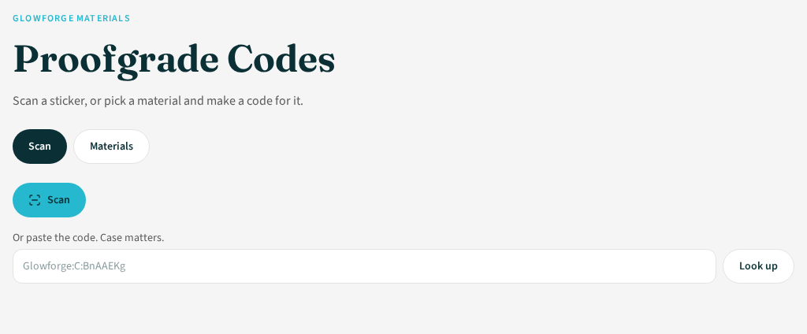
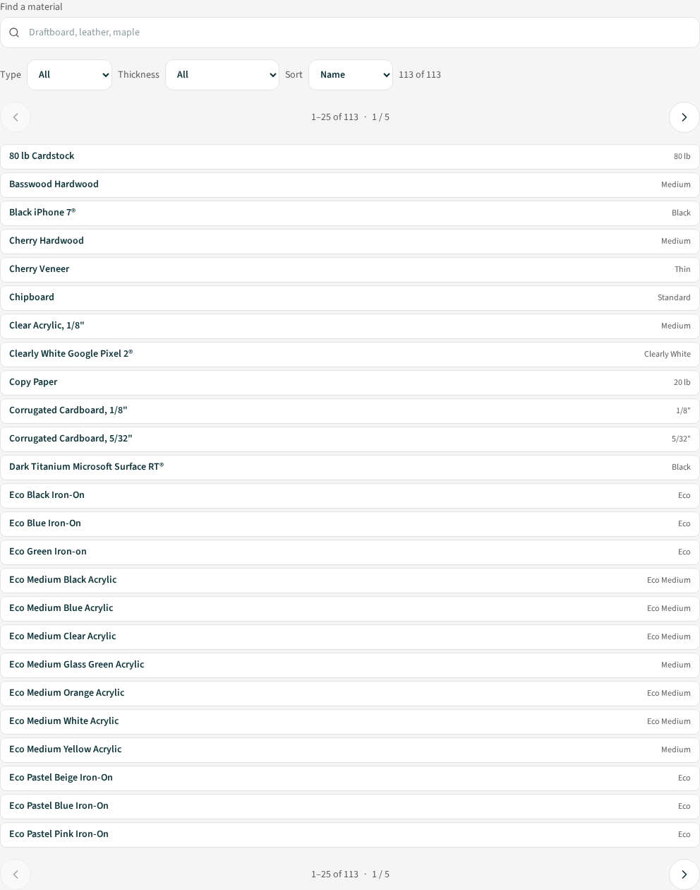
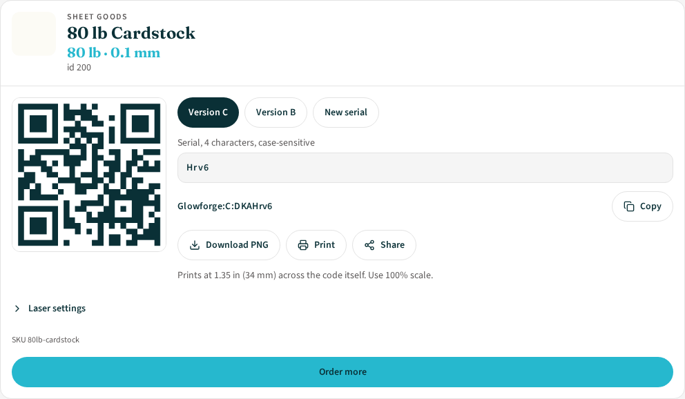
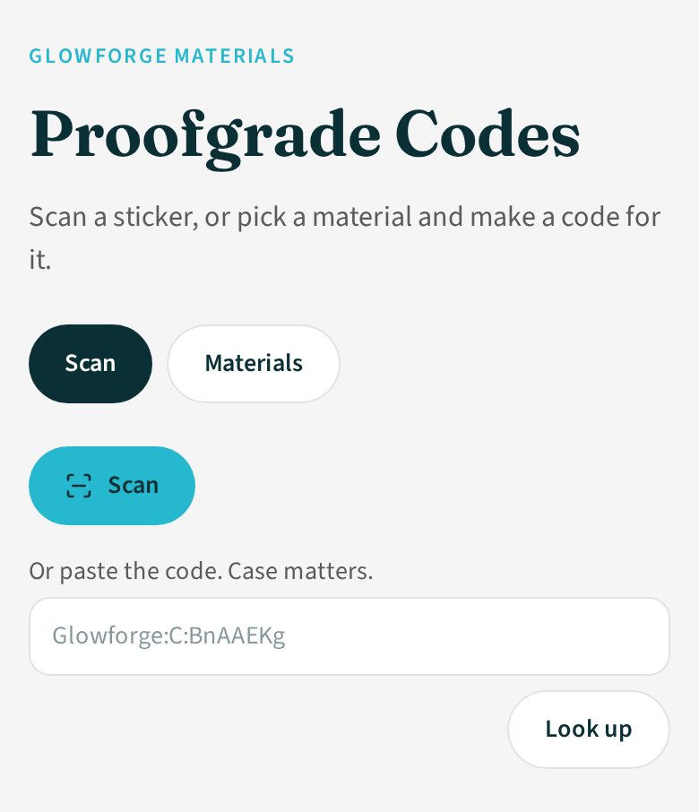

# Proofgrade Codes

Proofgrade Codes is a browser tool for Glowforge Proofgrade stickers. Scan the code on a sheet, or pick a material and make a code you can print, save, or send to someone else. Nothing is uploaded. The catalog, the camera scan, and the code all stay in the page you have open.

A link is the code. When you pick a material, scan a sticker, or change the version or serial, the address bar updates to that exact sticker text. Copy the address, or use Share, and the person who opens it lands on the same material and the same code.



## What you can do

Scan a sticker with the phone or computer camera. If you already have the text, paste it. Capital and lowercase letters are different, so the code has to match the sticker exactly.

If the scan is a Proofgrade sticker, the page scrolls to that material and highlights it. If the text is not a sticker, or the sticker is not in this catalog, the page says so and shows the text it read.

The materials list is the Glowforge catalog bundled with the app, 113 entries. Search by name, then narrow it with the type menu and the thickness menu. Thickness is the real size, in inches and millimeters, not a separate code. Sort by name, catalog id, sticker code, or thickness. The list shows 25 materials at a time, with back and next controls.

Open a material and the page makes a code for it, with a new serial each time you click one. Change the version or ask for another serial if you want a different sheet. Copy sits on the code itself. Next to that are Download PNG, Print, and Share.

Print is sized to the code on a Proofgrade sheet: 1.35 in (34 mm) across the code, not the quiet zone around it. Leave the print dialog at 100% scale. The PNG is the same artwork if you would rather drop it into a label document.

Share sends the page address, which already contains the code. If the browser cannot open the share sheet, the button copies the link instead.

Order more opens the Glowforge shop on that material. Where the shop sells the color, the link selects the matching thickness, including Eco Thin on the colors that have it. Eco iron-on opens the matching sheet or color pack.

Laser settings stay tucked in a drawer. Open it for cut, score, vector, and photo, and switch the tube when the catalog has more than one. Those numbers come from the catalog. They are not stored on the sticker.





On a phone the scan control stays in reach, and the same address still carries the code.



## Run it

```bash
npm install
npm run dev
```

Open [http://127.0.0.1:8080](http://127.0.0.1:8080).
